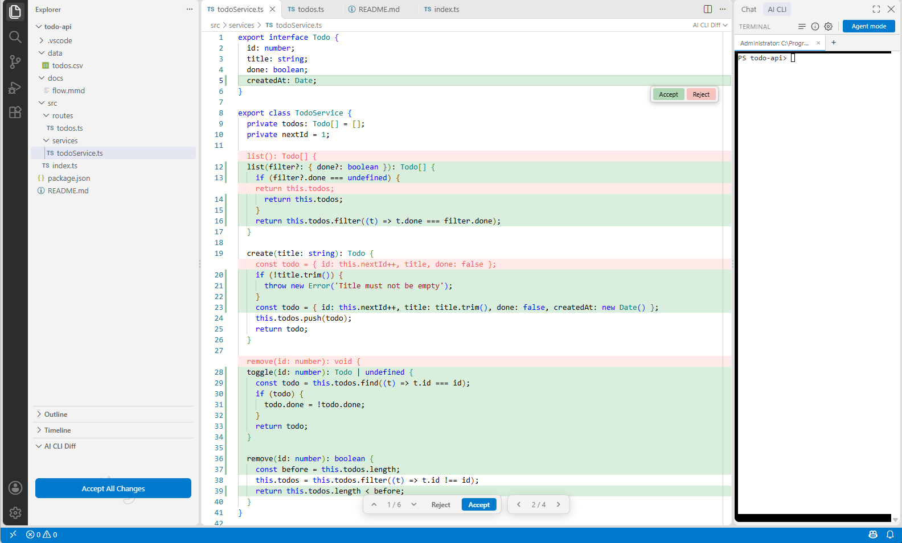
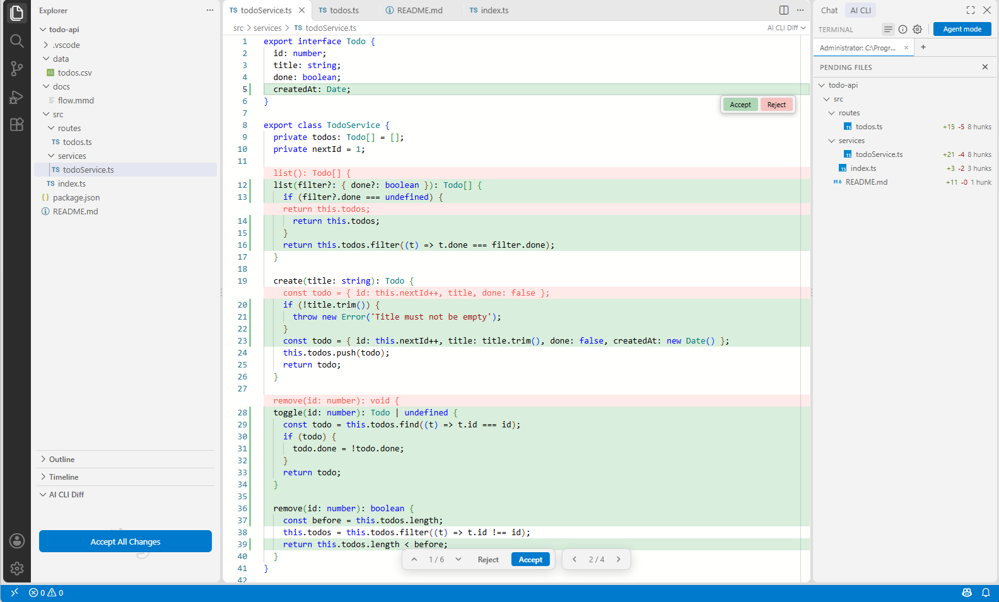
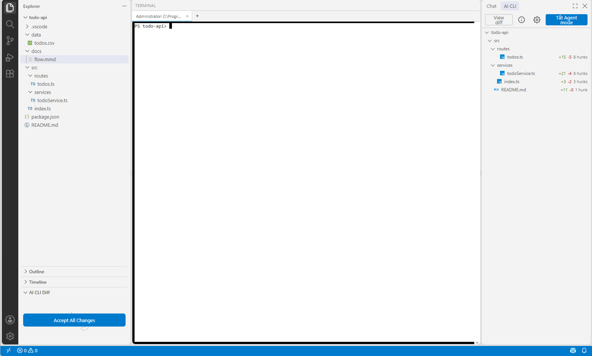
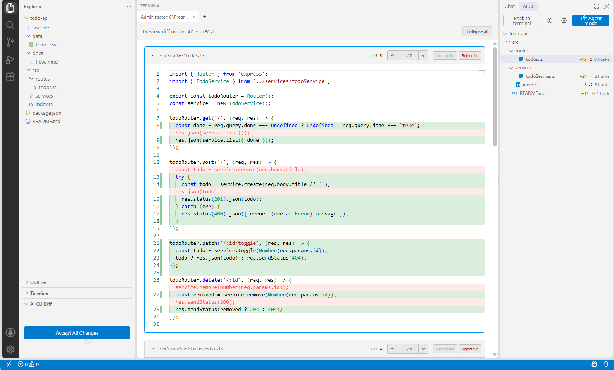
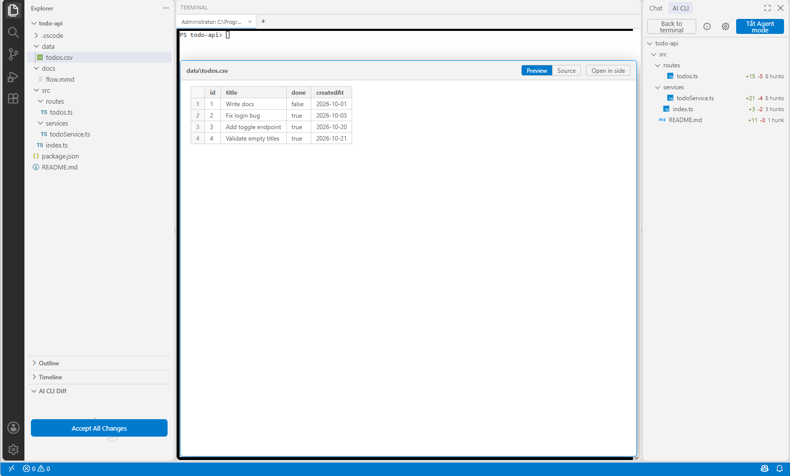
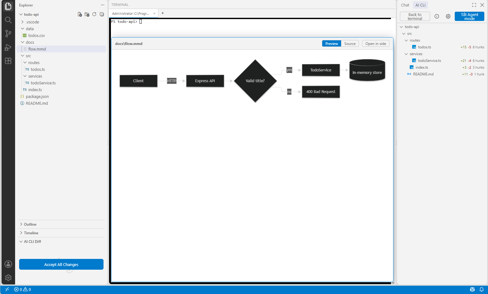
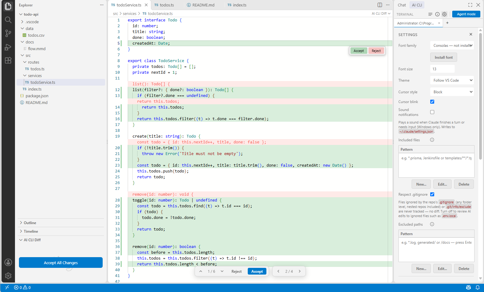

# AI CLI Diff View

Cursor-like diff review for any AI CLI agent's file edits — right inside VS Code.

Run Claude, Codex, Qwen or any other AI CLI. Every file it touches becomes a reviewable diff you can accept or reject block by block — no setup, no hooks. Switch to **Agent mode** for a full-screen terminal with a live tree of changed files, an all-in-one diff view and instant previews.



## Features

### Works with any AI CLI

- Detects edits from any tool that writes files in your workspace — Claude, Codex, Qwen, Gemini, Aider and others. Nothing to install or configure in the CLI.
- Tells AI edits apart from git: switching branches clears stale diffs, and `pull`, `merge`, `rebase` or `reset` don't flood you with diffs.
- Pending diffs survive a VS Code restart.

### Cursor-like diff review

- Each changed file opens as a diff tab; removed lines sit right above the lines that replaced them.
- Accept or reject each change block with one click, or `Ctrl+Y` / `Ctrl+N`.
- Old and new lines are paired even when a block adds or removes lines, so every edited line gets its own buttons.
- Edit the new side directly inside the diff, with `Ctrl+S`, undo and redo.
- Jump between blocks with `F7` / `Shift+F7` and between files with `Alt+H` / `Alt+L`; accept or revert a whole file with `Ctrl+Shift+Y` / `Ctrl+Shift+Z`, or every pending file at once.

### Pending Files

See every changed file in its real folder structure, with `+/-` line counts and the number of hunks.



### Agent mode

Turn the terminal into a central agent workspace: the terminal takes the editor area, other tabs are hidden, and the changed-files tree stays beside it.



Review all changes in one scrolling page, with **Accept file** / **Reject file** and change-by-change navigation for each file. Click a file in the tree to jump to it.



Open any file and preview it in place while the terminal keeps focus — Markdown, images and SVG, CSV/TSV tables, Mermaid diagrams and code. Use **Open in side** to send it to a regular editor.

| CSV preview | Mermaid preview |
| --- | --- |
|  |  |

### Integrated terminal

- A real terminal (node-pty + xterm.js) with multiple tabs, shown in the Secondary Side Bar next to your code.
- Shells keep running when you toggle Agent mode or open Pending Files.
- Terminal themes (Follow VS Code, Dark, Solarized Dark, Dracula, Custom), font, size and cursor style; one-click install of Fira Code or JetBrains Mono.
- Start a Claude session directly with `Ctrl+Shift+A`.
- Optional sound when Claude finishes a turn or needs your input (Windows only).

### Choose what gets tracked

Everything is editable from the Settings popover in the terminal panel — no need to open `settings.json`.

- **Included files** — track extra files with `.gitignore` syntax: `*.prisma`, `Jenkinsfile`, `templates/**/*.tpl`; `!*.lock` stops tracking a built-in type.
- **Excluded paths** — ignore folders or files: `generated/`, `*.log`, `src/gen/**`.
- **Respect .gitignore** (on by default) — files ignored by git are never tracked, including nested `.gitignore` files and `.git/info/exclude`.
- Binary files and very long files (`maxFileLines`, default 5000) are skipped automatically.



### Fast on large workspaces

An agent can rewrite hundreds of files without freezing VS Code: at most `maxAutoOpenDiffs` diff tabs (default 50) open automatically, in batches, and the rest wait in Pending Files.

## Usage

1. Open the `AI CLI` panel in the Secondary Side Bar.
2. Run an AI CLI agent — Claude, Codex, Qwen, or anything else — in the integrated terminal or an external one. Edits are picked up automatically.
3. Review each diff and accept or reject per block, per file, or all pending changes at once.
4. Optional: click **Agent mode** for a full-screen agent workspace.

## Commands

- `AI CLI Diff: Start Claude Session`
- `AI CLI Diff: Toggle Agent Mode`
- `AI CLI Diff: Accept All Changes`
- `AI CLI Diff: Accept All Changes (All Files)`
- `AI CLI Diff: Revert All Changes`
- `AI CLI Diff: Open Pending File`
- `AI CLI Diff: Previous Edited File`
- `AI CLI Diff: Next Edited File`

## Keybindings

| Key | Action |
| --- | --- |
| `Ctrl+Shift+A` / `Cmd+Shift+A` | Start a Claude session |
| `Ctrl+Shift+Y` / `Cmd+Shift+Y` | Accept all changes in the current diff |
| `Ctrl+Shift+Z` / `Cmd+Shift+Z` | Revert all changes in the current diff |
| `Alt+H` / `Alt+L` | Previous / next edited file |
| `Ctrl+Y` / `Ctrl+N` (in a diff) | Accept / reject the current change block |
| `F7` / `Shift+F7` (in a diff) | Next / previous change block |

## Settings

| Setting | Default | Description |
| --- | --- | --- |
| `ai-cli-diff-view.includedPaths` | `[]` | Extra files to track, `.gitignore` syntax |
| `ai-cli-diff-view.excludedPaths` | `[]` | Extra paths to ignore, `.gitignore` syntax |
| `ai-cli-diff-view.respectGitignore` | `true` | Skip files ignored by git |
| `ai-cli-diff-view.supportedFileDetectionMode` | `defaultAndCustom` | `customOnly` tracks only `includedPaths` |
| `ai-cli-diff-view.maxFileLines` | `5000` | Ignore files longer than this (`0` disables) |
| `ai-cli-diff-view.maxAutoOpenDiffs` | `50` | Most diff tabs opened automatically (`0` disables) |
| `ai-cli-diff-view.soundNotificationsEnabled` | `false` | Sound when Claude finishes or needs input (Windows) |

Advanced: `baselineScanConcurrency` and the `burstDetection*` settings tune the initial workspace scan and how git checkouts are told apart from AI edits.

## Development

```bash
npm install
npm run compile
```

Press `F5` in VS Code to launch the Extension Development Host.

Package the extension:

```bash
npx @vscode/vsce package
```

## License

[AGPL-3.0](LICENSE)
