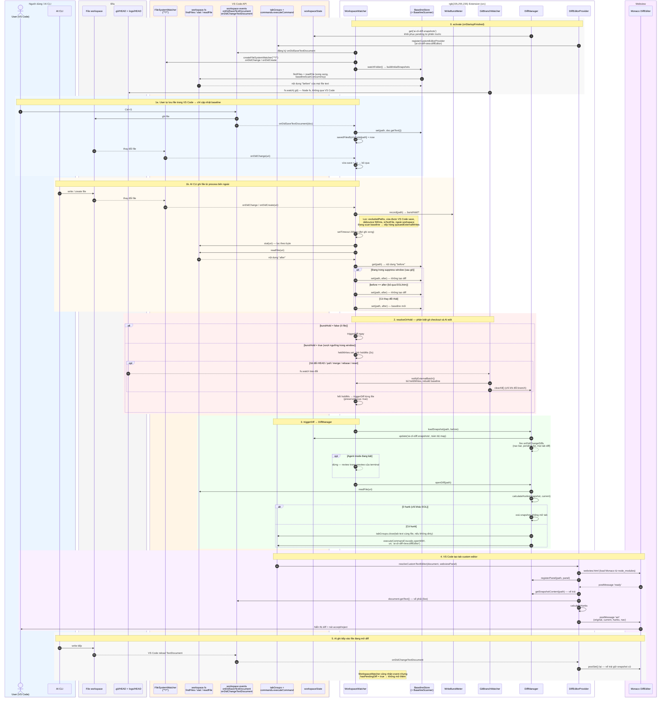

# Luồng bắt diff — swimlane theo tầng

> Chỉ mô tả việc **phát hiện edit và mở diff** (workspace watcher). Không gồm
> accept/revert, built-in runner (`startSession`) hay agent-mode preview.
> Đối chiếu code 4.1.2 — nếu lệch, tin code.

Các tầng (từ trái sang phải):

| Tầng | Gồm | Ghi chú |
| --- | --- | --- |
| **Người dùng / AI CLI** | User gõ trong VS Code, AI CLI (Claude/Codex/Qwen) chạy ngoài | AI CLI **không** nói chuyện với extension — chỉ ghi file |
| **Đĩa** | File trong workspace, `.git/HEAD`, `.git/logs/HEAD` | |
| **VS Code (API)** | `FileSystemWatcher`, `workspace.fs`, `onDidSaveTextDocument`, `tabGroups`, `vscode.openWith`, `workspaceState` | Mọi thứ extension làm với editor đều đi qua tầng này |
| **Extension (src)** | `WorkspaceWatcher`, `BaselineStore`, `WriteBurstMeter`, `GitBranchWatcher`, `DiffManager`, `DiffEditorProvider` | `GitBranchWatcher` là ngoại lệ: đọc `.git` bằng Node `fs` trực tiếp, không qua VS Code |
| **Webview** | Monaco `DiffEditor` (`res/webview/diff.monaco.js`) | Chỉ nhận dữ liệu qua `postMessage` |

## Extension chạm vào VS Code ở đâu (tóm tắt)

| Mục đích | VS Code API | Nơi gọi |
| --- | --- | --- |
| Phát hiện file đổi từ bên ngoài | `workspace.createFileSystemWatcher('**/*')` | `WorkspaceWatcher.watchWorkspaceFolders` |
| Phân biệt save của chính VS Code | `workspace.onDidSaveTextDocument` | `WorkspaceWatcher.watchVscodeEvents` |
| Chụp baseline ban đầu | `workspace.findFiles`, `workspace.fs.readFile` | `BaselineScanner.buildInitialSnapshots` |
| Đọc nội dung sau khi AI ghi | `workspace.fs.stat`, `workspace.fs.readFile` | `WorkspaceWatcher.processExternalWrite`, `DiffManager.openDiff` |
| Lưu pending qua restart | `ExtensionContext.workspaceState` | `SnapshotStore.save/load` |
| Đóng tab text trùng file | `window.tabGroups.close` | `DiffManager.closeTextTabsFor` |
| Mở tab diff | `commands.executeCommand('vscode.openWith', …)` | `DiffManager.openDiff` |
| Render diff | `registerCustomEditorProvider` + `WebviewPanel.postMessage` | `DiffEditorProvider.resolveCustomTextEditor` |
| Theo dõi nội dung live | `workspace.onDidChangeTextDocument` | `DiffEditorProvider` |
| Theo dõi git | *(không qua VS Code)* Node `fs.watch` + `fs.readFileSync` | `GitBranchWatcher` |
