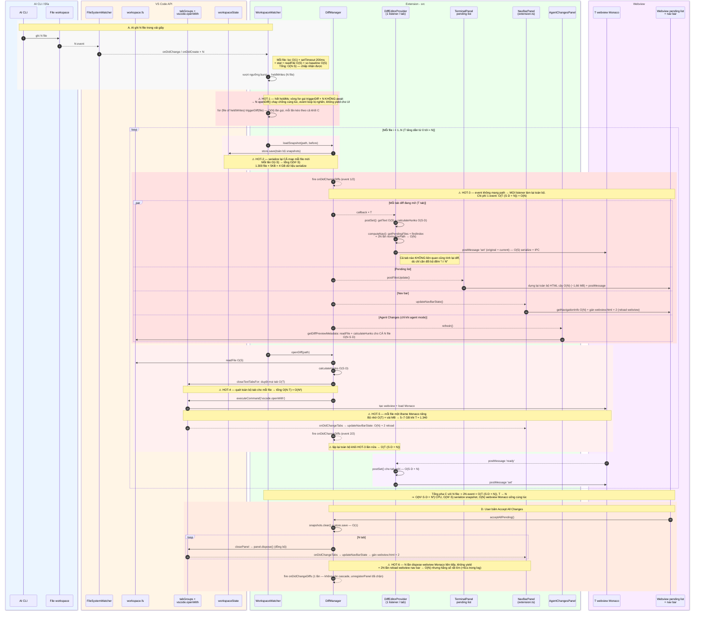

# Điểm nghẽn hiệu năng khi AI ghi hàng loạt file (issue #37)

> Phân tích tĩnh trên code 4.1.2 — **chưa profile**. Độ phức tạp là ước lượng theo
> code, hằng số thực tế cần đo. Luồng đầy đủ (không chú thích hiệu năng):
> [DIFF_CAPTURE_SWIMLANE.md](DIFF_CAPTURE_SWIMLANE.md).

## Ký hiệu

| Ký hiệu | Nghĩa | Kịch bản issue #37 |
| --- | --- | --- |
| **N** | số file pending | ~1.300 |
| **T** | số tab diff đang mở (≈ N khi auto-open hết) | ~1.340 |
| **S** | kích thước một file (dòng / byte) | ≤ `maxFileLines` (5.000) |
| **D** | số dòng khác nhau giữa snapshot và hiện tại | Myers: **O((S)·D)** |

`normalizePath()` = `path.resolve` + `Uri.file().fsPath` + `toLowerCase` — rẻ nhưng không
miễn phí, và bị gọi **O(T·N)** lần mỗi event (xem HOT-3).

## Sơ đồ

## Bảng tổng hợp

| # | Vị trí | Mỗi lần | Số lần (N file) | Tổng | Hướng sửa |
| --- | --- | --- | --- | --- | --- |
| HOT-1 | `workspaceWatcher.ts:517` `scheduleHoldResolve` | O(1) gọi `triggerDiff` | N, không await | N × (khối C) chạy chồng | Hàng đợi, batch nhỏ + `await`; ngưỡng tối đa số tab tự mở |
| HOT-2 | `diffManager.ts:204` → `snapshotStore.ts:35` | O(i·S) | N | **O(N²·S)** | Debounce `store.save`, flush khi `deactivate` |
| HOT-3a | `diffWebviewPanel.ts:157` listener → `postSet` | O(S·D) mỗi tab | 2N event × T tab | **O(N²·S·D)** | Chỉ tab của file vừa đổi mới `postSet`, tab khác nhận message `nav` nhỏ |
| HOT-3b | `diffWebviewPanel.ts:229` `computeNav` | O(N) | 2N event × T tab | **O(N³)** | Tính nav một lần mỗi event (map path → index), dùng chung cho mọi tab |
| HOT-3c | `terminalPanel.ts:245` `postFilesUpdate` | O(N) + ~1,66 MB IPC | 2N | O(N²) | Coalesce event, cập nhật từng dòng |
| HOT-3d | `extension.ts:440` `updateNavBarState` | O(N) + 2 reload webview | 2N + số lần đổi tab | O(N²) | Coalesce, gán `html` 1 lần hoặc `postMessage` |
| HOT-3e | `agentChangesPanel.ts:46` → `getDiffPreviewMetadata` | O(N·S·D) + N `readFile` | 2N (agent mode) | **O(N²·S·D)** | Coalesce, cache metadata theo file |
| HOT-4 | `diffManager.ts:177` `closeTextTabsFor` | O(T) | N | O(N²) | Index tab theo path (cập nhật từ `onDidChangeTabs`) |
| HOT-5 | `vscode.openWith` mỗi file | vài MB RAM | N | O(N) RAM, 5–7 GB | Giới hạn số tab tự mở, review gộp khi vượt ngưỡng |
| HOT-6 | `diffManager.ts:272` `acceptAllPending` | dispose 1 webview + 2 reload nav bar | N | O(N), hằng số lớn | `tabGroups.close(tabs[])` một lần, tạm khoá `updateNavBarState` |

**Thứ tự ưu tiên:** HOT-3a + HOT-3b (một chỗ sửa trong listener của `DiffEditorProvider`) →
coalesce event (HOT-3c/d/e) → HOT-2 → HOT-1/HOT-5 (đổi hành vi, đi cùng phần UX của issue).
